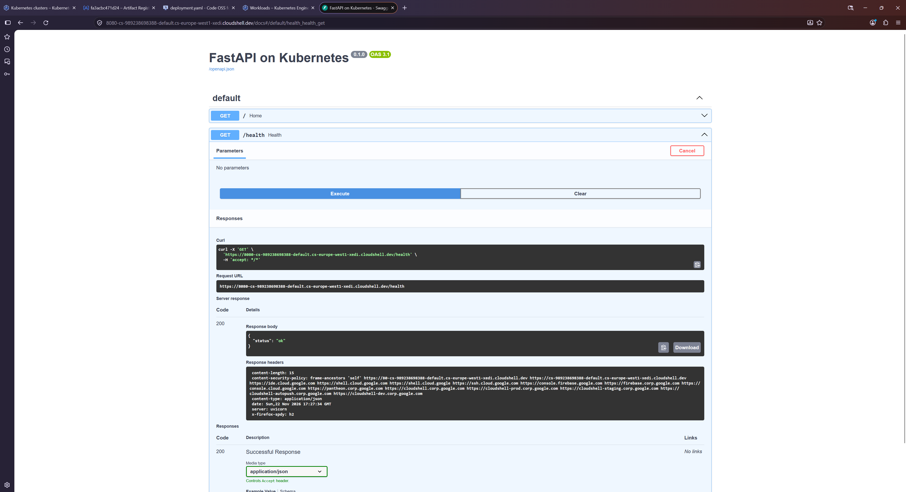

# Week 7 Homework 1 — Kubernetes practice and reflection

## Practical Evidence

### API health check

Hitting the API's health endpoint, which thankfully reports that everything is
hunky dory!

### Rolling out v2

    jho_recruitment@cloudshell:~/week7-cc/class-7/lab (cc-2026-johornsby)$ curl http://localhost:8080; echo
    Handling connection for 8080
    {"message":"Hello from FastAPI on Kubernetes"}
    jho_recruitment@cloudshell:~/week7-cc/class-7/lab (cc-2026-johornsby)$ kubectl apply -f k8s/deployment.yaml 
    deployment.apps/fastapi configured
    jho_recruitment@cloudshell:~/week7-cc/class-7/lab (cc-2026-johornsby)$ kubectl rollout status deployment/fastapi --timeout=10m
    Waiting for deployment "fastapi" rollout to finish: 1 out of 2 new replicas have been updated...
    Waiting for deployment "fastapi" rollout to finish: 1 out of 2 new replicas have been updated...
    Waiting for deployment "fastapi" rollout to finish: 1 out of 2 new replicas have been updated...
    Waiting for deployment "fastapi" rollout to finish: 1 old replicas are pending termination...
    Waiting for deployment "fastapi" rollout to finish: 1 old replicas are pending termination...
    Waiting for deployment "fastapi" rollout to finish: 1 old replicas are pending termination...
    deployment "fastapi" successfully rolled out
    jho_recruitment@cloudshell:~/week7-cc/class-7/lab (cc-2026-johornsby)$ kubectl get replicasets -l app=fastapi
    NAME                 DESIRED   CURRENT   READY   AGE
    fastapi-5549cfb54d   0         0         0       41m
    fastapi-868c56b9     2         2         2       34s
    jho_recruitment@cloudshell:~/week7-cc/class-7/lab (cc-2026-johornsby)$ kubectl describe deployment fastapi
    Name:                   fastapi
    Namespace:              default
    CreationTimestamp:      Sun, 22 Nov 2026 17:22:20 +0000
    Labels:                 <none>
    Annotations:            autopilot.gke.io/resource-adjustment:
                            {"input":{"containers":[{"limits":{"cpu":"250m","memory":"512Mi"},"requests":{"cpu":"250m","memory":"512Mi"},"name":"fastapi"}]},"output":...
                            autopilot.gke.io/warden-version: 37.9.0-gke.3
                            deployment.kubernetes.io/revision: 2
    Selector:               app=fastapi
    Replicas:               2 desired | 2 updated | 2 total | 2 available | 0 unavailable
    StrategyType:           RollingUpdate
    MinReadySeconds:        0
    RollingUpdateStrategy:  25% max unavailable, 25% max surge
    Pod Template:
    Labels:  app=fastapi
    Containers:
    fastapi:
        Image:      europe-west1-docker.pkg.dev/cc-2026-johornsby/lab7-containers-jhorns01/fastapi:v2
        Port:       8080/TCP (http)
        Host Port:  0/TCP (http)
        Limits:
        cpu:                250m
        ephemeral-storage:  1Gi
        memory:             512Mi
        Requests:
        cpu:                250m
        ephemeral-storage:  1Gi
        memory:             512Mi
        Liveness:             http-get http://:http/health delay=0s timeout=1s period=10s successThreshold=1 failureThreshold=3
        Readiness:            http-get http://:http/health delay=0s timeout=1s period=10s successThreshold=1 failureThreshold=3
        Environment:          <none>
        Mounts:               <none>
    Volumes:                <none>
    Node-Selectors:         <none>
    Tolerations:            kubernetes.io/arch=amd64:NoSchedule
    Conditions:
    Type           Status  Reason
    ----           ------  ------
    Available      True    MinimumReplicasAvailable
    Progressing    True    NewReplicaSetAvailable
    OldReplicaSets:  fastapi-5549cfb54d (0/0 replicas created)
    NewReplicaSet:   fastapi-868c56b9 (2/2 replicas created)
    Events:
    Type    Reason             Age   From                   Message
    ----    ------             ----  ----                   -------
    Normal  ScalingReplicaSet  41m   deployment-controller  Scaled up replica set fastapi-5549cfb54d from 0 to 1
    Normal  ScalingReplicaSet  30m   deployment-controller  Scaled up replica set fastapi-5549cfb54d from 1 to 2
    Normal  ScalingReplicaSet  48s   deployment-controller  Scaled up replica set fastapi-868c56b9 from 0 to 1
    Normal  ScalingReplicaSet  34s   deployment-controller  Scaled down replica set fastapi-5549cfb54d from 2 to 1
    Normal  ScalingReplicaSet  34s   deployment-controller  Scaled up replica set fastapi-868c56b9 from 1 to 2
    Normal  ScalingReplicaSet  22s   deployment-controller  Scaled down replica set fastapi-5549cfb54d from 1 to 0
    jho_recruitment@cloudshell:~/week7-cc/class-7/lab (cc-2026-johornsby)$ curl http://localhost:8080; echo
    Handling connection for 8080
    E1122 18:04:37.004480    3898 portforward.go:549] "An error occurred forwarding" err="error forwarding port 8080 to pod d6347c86c794f11da9f8d0ed3f491801e090ce325ffa255a7b8f7f643a65f685, uid : failed to find sandbox \"d6347c86c794f11da9f8d0ed3f491801e090ce325ffa255a7b8f7f643a65f685\" in store: not found" localPort=8080
    remotePort=8080
    curl: (52) Empty reply from server
    error: lost connection to pod

    jho_recruitment@cloudshell:~/week7-cc/class-7/lab (cc-2026-johornsby)$ fg
    -bash: fg: job has terminated
    [1]+  Exit 1                  kubectl port-forward service/fastapi 8080:80
    jho_recruitment@cloudshell:~/week7-cc/class-7/lab (cc-2026-johornsby)$ kubectl port-forward service/fastapi 8080:80 &
    [1] 4308
    jho_recruitment@cloudshell:~/week7-cc/class-7/lab (cc-2026-johornsby)$ Forwarding from 127.0.0.1:8080 -> 8080

    jho_recruitment@cloudshell:~/week7-cc/class-7/lab (cc-2026-johornsby)$ curl http://localhost:8080; echo
    Handling connection for 8080
    {"message":"Hello from FastAPI v2 on Kubernetes"}
    jho_recruitment@cloudshell:~/week7-cc/class-7/lab (cc-2026-johornsby)$ 

At the top of this terminal excerpt we can see the v1 message, and then at the
bottom we can see that it's now reporting the v2 message.  The random
"An error occurred forwarding" bit occurred because `kubectl port-forward` was
already running as a background job.

## Diagnosing a broken Service

Incorrect `service.yaml`:

    apiVersion: v1
    kind: Service
    metadata:
      name: fastapi
    spec:
      type: ClusterIP
      selector:
        app: courses-api
    ports:
        - name: http
          port: 80
          targetPort: http

The line that is wrong here is the `app` one, it should be `fastapi` rather than
`courses-api`.  This is because in the `deployment.yaml` we have the following:

    apiVersion: apps/v1
    kind: Deployment
    metadata:
      name: fastapi
    spec:
      replicas: 1
      selector:
        matchLabels:
          app: fastapi
      template:
        metadata:
          labels:
            app: fastapi
    [...]

That is, the pod template specifies that the pods are labelled as
`app: fastapi`.  Since a Kubernetes Service effectively sits on top of pods, the
pods can come up fine and think everything is ok, while the Service is unable
to resolve its pods due to an incorrect label in its selector.

Once the `services.yaml` is corrected, it should be reapplied like so:

    kubectl apply -f service.yaml

At which point I would ultimately expect something similar to the following:

    jho_recruitment@cloudshell:~/week7-cc/class-7/lab (cc-2026-johornsby)$ kubectl get endpointslices -l kubernetes.io/service-name=fastapi
    NAME            ADDRESSTYPE   PORTS   ENDPOINTS                   AGE
    fastapi-wgmr4   IPv4          8080    10.86.128.15,10.86.128.16   11m
    jho_recruitment@cloudshell:~/week7-cc/class-7/lab (cc-2026-johornsby)$ 

In particular, note that there are 2 _ENDPOINTS_.

## Reflection

The lab exercise this week demonstrates that it is the Deployment spec that
defines how many copies of FastAPI should run via the number of replicas
specified.  Together these replicas form a ReplicaSet.  Kubernetes is
responsible for maintaining the target number of replicas in the ReplicaSet, and
thus if a Pod disappears, it will create a new one to fill the gap.  This is
largely invisible to users of a Service as an internal service proxy knows to
route only to healthy Pods.

The code behind the `/health` endpoint as currently written demonstrates a
potential shortcoming of the application's ability to determine _how_ healthy it
is.  All it really does is demonstrate that the HTTP stack (i.e., FastAPI) is
functional.  To assert much more is somewhat tricky as the application is
responsible for automatically bootstrapping the database itself.  A slightly
less naive implementation might consider reporting additional facts, such as
whether the database had to be created on startup.
